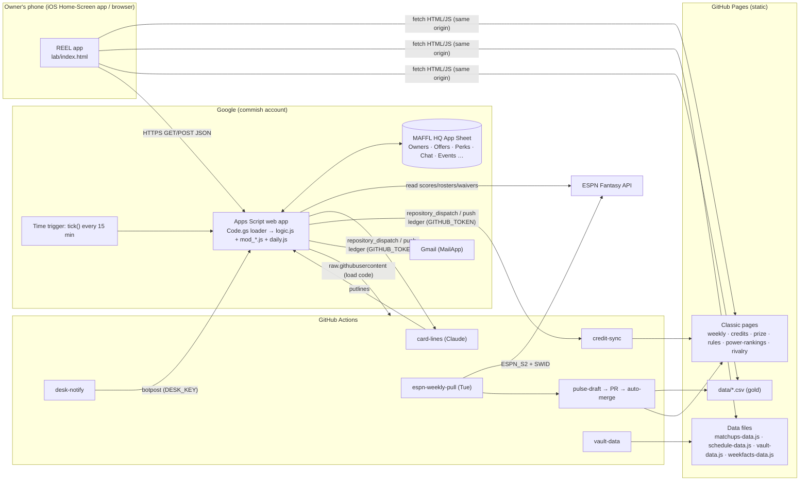

# REEL — Operations & Architecture Handbook

_Last updated: 2026-11-10 (chat). Living doc: update it in the same commit whenever a part, robot, tab, secret or
schedule is added, renamed or retired._

**Who this is for:** someone technical who has never seen MAFFL HQ and needs to understand how it is built, how it
runs, and how to keep it running. Plain-language product docs live elsewhere (`REEL.md`, `APP_DESIGN.md`).

**Companion docs:** `CLAUDE.md` (binding rules) · `MAFFL_HQ_DATA_GOVERNANCE.md` (gold data, chain events) ·
`MAFFL_HQ_OPERATIONS_RUNBOOK.md` (classic site publish loop) · `_ops/docs/REEL.md` (product map, roadmap, backlog) ·
`_ops/docs/APP_DESIGN.md` (decision journal) · `_ops/AUDIT_2026-11-07_reel_readiness.md` (security/robustness audit).

---

## 1. The system in one paragraph

MAFFL HQ is a **static website on GitHub Pages** (`maffl-commish.github.io/maffl/`, repo `maffl-commish/maffl`)
with no server of its own. Historical league data lives in **gold CSVs** in the repo and is baked into JS/HTML by
generators. The new app, **REEL** (`lab/index.html`, one ~490 KB self-contained page), adds identity and
interactivity by talking to a **Google Apps Script web app** bound to a **Google Sheet** (the "MAFFL HQ App"
Sheet), which is the app's database. Live scores and rosters come from **ESPN's fantasy API**, read by the Apps
Script backend and by **GitHub Actions** robots. **Claude** writes short editorial copy (card lines, the classic
Weekly Pulse) inside Actions, and does all development through chat sessions that push to `main`.

## 2. Architecture

### Key design choices (and why)

| Choice | Why | Consequence |
|---|---|---|
| Static site, no build server | Free, zero-ops, survives neglect | All data is pre-baked or fetched client-side; generators run in Actions or on Windows |
| Google Sheet as the database | Commish can read/fix rows by hand; free; email built in | Row-scan performance; 6-min execution and quota limits; one global lock |
| Loader pattern (`Code.gs` fetches `logic.js` from `main`) | Ship backend by `git push`, no Apps Script redeploys | **Pushing backend code = deploying it.** 5-min cache, 6-h last-good fallback |
| Passphrase, not accounts | No passwords, no OAuth, typed once per phone | Salted, peppered HMAC hashes; device tokens; rate-limited guesses |
| ESPN is truth for rosters/scores; REEL is truth for credits | REEL never writes lineups or rosters | Approved trades become a "Do on ESPN" step for the commish |
| Gold → derived, never hand-edit | Historical numbers must agree everywhere | Changes go through generators (`build\*.ps1`, `_ops/scripts/*.py`) |

## 3. Inventory

### 3a. Front end (GitHub Pages)

| File | Role | Notes |
|---|---|---|
| `lab/index.html` | **The REEL app** (Home reel, Match, Team, Chat, League, desk) | Hidden, `noindex` until go-live. `STAGE = "beta"` switch. Talks to `API_URL` (Apps Script). Self-checks for updates every 10 min |
| `lab/vault-data.js` | League history for the Vault | DERIVED by `gen_vault.py` (workflow `vault-data.yml`) |
| `lab/weekfacts-data.js` | Week facts for quiz cards | DERIVED by `gen_lab_weekfacts.py` (in `pulse-draft.yml`) |
| `index.html` | Classic home page | Becomes the app at go-live (§7) |
| `weekly.html` | Classic Weekly Pulse | **Boot-critical for the app**: app reads `const WEEKS` and `SHORT_NAMES` |
| `credits.html` | Credit registry | App reads `REGISTRY_DATA` for every balance; written by credit-sync |
| `prize.html` | Prizes & dues | App reads `const MAFFL` |
| `rules.html` | Rulebook | App parses `.rule-section/.rule-title/.rule-body` |
| `power-rankings.html` | Owner ratings | App reads `OWNERS_DATA` (hand-authored data inside a page — known debt) |
| `rivalry.html` | Rivalry view | App iframes `?embed=1#vs=A,B` |
| `history.html`, `draft.html`, `draftday.html`, `stats.html`, `overview.html`, `speakup.html` | Classic pages | Linked from the app or retire candidates (audit Part C) |
| `matchups-data.js`, `schedule-data.js`, `key-dates-data.js`, `draft-summary-data.js` | Derived data | Generated; never hand-edit |
| `manifest.json`, `maffl-logo-*.png` | Home-Screen install | `start_url ./index.html` |

### 3b. Backend (Google Apps Script, bound to the "MAFFL HQ App" Sheet)

| File (repo `_ops/apps-script/`) | Role |
|---|---|
| `Code.gs` | **Loader.** The only file pasted into Apps Script. Fetches `logic.js` from `main`, caches 5 min, keeps a 6-h last-good copy. Owns `doGet/doPost`, the Sheet menu, and `tick()`. Changes rarely; changing it = re-paste + Deploy → New version |
| `logic.js` | **Core** (v0.64): routing, sign-in, settings, summary, Sheet helpers, `safe_()` formula guard, exports. Config constants: `VERSION`, `APP_URL`, `OWNER_EMAILS` |
| `mod_trades.js` | Offers, counters, accept/decline, commish approve/negate, perks, credit balance checks, credit sync push |
| `mod_espn.js` | ESPN reads: live scores, rosters (30-min cache, 6-h last good), schedule |
| `mod_social.js` | Chat rooms/DMs, reads, reactions, polls in chat, feedback, tap log |
| `mod_desk.js` | Commish desk (dashboard, to-dos, log), polls, botposts, the 15-min `tick`, seed data |
| `daily.js` | In-season daily run (5 AM/5 PM ET): scores, records, Survivor, Coach of the Week, moves, waivers (FAAB), Ghost par, drops, credit races. Loaded on demand |

Deployment: Web app, **Execute as: Me (commish)**, **Who has access: Anyone**. Current deployment Version 5 (11/7).
Every file must stay under ~90 KB (CacheService limit). Bump `VERSION` in `logic.js` when any part changes.

**API actions** (`?action=` / POST `action`): `login request react vote summary block offer respond commish perk
perkact settings savesettings resync chat chatsend chatmod board inbox desk deskact feedback taplog botpost putlines`
(+ `live`, `rosters`, `daily` GETs). Auth: device token from `login`; commish-only actions check `is_commish` on the
server; robot actions (`botpost`, `putlines`) need `DESK_KEY`.

### 3c. Database: the "MAFFL HQ App" Sheet (tabs)

| Tab | Columns (key ones) | Written by | Notes |
|---|---|---|---|
| **Owners** | owner, team, tier, pin_hash, salt, commish, beta, handle, email, phone, notify (JSON), failed_tries, locked, tour | Commish menu, settings, desk | **PII lives only here**, never in the repo |
| **Offers** | offer_id, ts, from_owner, to_owner, tier, give, get, give_credits, get_credits, note, status, updated_ts, reason, reasons, sync (+ stage) | Trades | Status machine: OPEN → COUNTERED / DECLINED / WITHDRAWN / ACCEPTED → APPROVED / NEGATED |
| **Perks** | perk_id, ts, owner, tier, perk, cost, qty, week, player, pos, swap_with, affects, note, status, updated_ts, reason, sync (+ stage) | Perk requests | Extra FAAB, Double Player Bonus, Matchup Swap, Relegation Insurance, Division Swap |
| **Events** | ts, owner, type, ref, value, week, meta | Everything | **Append-only audit log** (reactions, votes, trade steps, block listings, ESPN-step done, espn_when) |
| **Chat** | msg_id, ts, room, owner, kind, text, ref, event, mentions, reply_to, deleted, pinned (+ stage) | Chat, bots | Rooms: league, tier U/L, DMs, desk |
| **Reads** | owner, room, ts | Chat | Unread counts |
| **Polls** | question, options, scope, closes… | Desk | Votes go to Events |
| **Requests** | ts, owner, note, status… | Public `request` action | Passphrase requests; rate-limited |
| **Feedback** | fb_id, ts, owner, tier, kind, mood, where, note, ctx | 🧪 beta kit, 💡 Ideas & feedback | |
| **TapLog** | ts, owner, session, type, what, where | App (batched 60 s) | Beta analytics; grows fast |
| **Daily** | key → JSON (split across columns past 50k) | `daily.js` | Snapshots, drops, `faab_<tier>`, `pstart_<tier>`, `lines_w<N>`, `elite5_hist` |
| **Moves** | ts, tier, owner, team, type, player, pos, nfl, other | `daily.js` | ESPN adds/drops/trades |
| **Awards** | award_id, ts, tier, owner, team, award, credits, week, detail, status, updated_ts, reason, sync | `daily.js` → desk approve | Credit races / season awards |

Staged (seed) rows: id prefix `TSD`/`PSD`/`MSD` or `stage = seed`; block Events week `seed`. **Wipe seed** removes them.

### 3d. Script properties (Apps Script → Project settings)

| Property | Purpose | Set by |
|---|---|---|
| `GITHUB_TOKEN` | Fine-grained PAT (Contents RW on the repo): credit ledger push + `daily-lines` dispatch | Commish (once; rotate before expiry) |
| `DESK_KEY` | Shared secret for robots → desk posts (also a GitHub secret) | Commish |
| `CREDIT_SYNC` | `live` = real ledger; anything else = TEST dry run | Commish at go-live |
| `PIN_PEPPER` | HMAC pepper for passphrases (auto-created) | Backend — **never rotate casually: invalidates every passphrase** |
| `LAST_DAILY`, `LAST_TICK`, `LAST_SYNC`, `TICK_DAILY`, `TICK_SENT[_n]`, `ELITE5_POSTED`, `SEED_AT`, `WP_PROBE` | Robot state | Backend |

### 3e. GitHub Actions (`.github/workflows/`)

| Workflow | Trigger | Does | Secrets |
|---|---|---|---|
| `espn-weekly-pull.yml` | Tue cron ×5 + Wed backstop; dispatched by the Claude scheduled task Tue 5:07 AM ET | `maffl_espn_pull.py` → `_ops/inbox/MAFFL_2026_WeekNN_espn.md` | `ESPN_S2`, `SWID` |
| `pulse-draft.yml` | After the pull | Windows: gold append, corrections, CE-1, validate. Then Claude drafts the Week in `weekly.html` → PR → auto-merge if `check_pulse_week.py` passes | Anthropic key, `GITHUB_TOKEN` |
| `card-lines.yml` | `repository_dispatch: daily-lines` from `daily.js` | Claude writes Home card lines → `putlines` to the backend | Anthropic key, `DESK_KEY` |
| `credit-sync.yml` | Push to `_ops/inbox/credit_ledger*.json` | Ledger → `Credit_Log.csv` → `credits.html` (TEST = dry run) | — |
| `vault-data.yml` | Push to `data/**.csv`, Wed cron | Regenerates `lab/vault-data.js` | — |
| `desk-notify.yml` | After pull / pulse / sync / lines | Posts each robot's result to the 📥 desk | `DESK_KEY` |
| `build-check.yml` / `build-write.yml` | `build-fix/**` push / manual | Runs `build\*.ps1` on Windows (check / write) for chat sessions | — |
| `claude-mention.yml` | `@claude` comment | Claude edits that PR/issue branch | Anthropic key |
| `espn-draft-history.yml`, `rehearsal.yml` | Manual | One-offs | `ESPN_S2`, `SWID` |

Outside the repo: **Claude scheduled task "MAFFL Tuesday Pulse kickoff"** (Tue 5:07 AM ET) dispatches the pull,
watches the chain, retries once, pushes a phone report. **Apps Script time trigger** runs `tick()` every 15 min.

### 3f. Scripts and tests

- `_ops/scripts/*.py` — ESPN pull, Pulse facts/history/check, vault + week-facts generators, credit ledger apply,
  gold audits. Run in Actions (Linux) or a chat workspace.
- `build\*.ps1` — Windows PowerShell 5.1 generators + `validate.ps1` (8 gates). Chat runs them via `build-*.yml`.
- `_ops/tests/mock.js` + `regress.js` + `regress_expected.txt` — backend regression on a mocked Sheet/ESPN with a
  frozen clock. **Required before every backend push.** `shoot.py` — headless 390 px screenshots of the app.

### 3g. Data flows (the four that matter)

1. **Weekly results (classic):** ESPN → pull → gold `MAFFL_2026_append.csv` / Matchups → CE-1 → `matchups-data.js`
   + `weekly.html` WEEKS → app boot.
2. **Live (REEL):** ESPN → Apps Script `live`/`rosters` (cached) → app. Daily run → Daily tab → `daily` → cards.
3. **Credits:** perk/trade approved on the desk → Offers/Perks rows → ledger JSON pushed to `_ops/inbox/` →
   `credit-sync.yml` → `Credit_Log.csv` (gold) → `credits.html` → app balances. App shows approved-but-unposted
   moves immediately.
4. **Identity:** commish issues passphrase (desk or Sheet menu) → hash in Owners → owner types it → device token on
   the phone. New passphrase revokes old devices.

## 4. Running it

### 4a. Operating calendar (in season)

| When | What runs | Human touch |
|---|---|---|
| Every 15 min | `tick`: trade clock, reminders, players-moved-on-ESPN check, nightly credit check | None |
| 5 AM + 5 PM ET daily | Daily run → card lines (Claude) | None |
| Mon 5 PM ET | 🧮 Tonight's math drop | None |
| Tue 5:07 AM ET | ESPN pull → Pulse draft → auto-merge; vault refresh Wed | Read the phone report; fix if it failed |
| Tuesdays | Desk "Do on ESPN" steps (Ghost score, Double Bonus, approved trades) | **Commish does these in ESPN** |
| On demand | Approve trades/perks, passphrase requests, polls | Commish, from the desk |

### 4b. Health checks

- 📥 desk → 🤖 Robots row: each robot's last run and state ("all running").
- Apps Script → Executions: failures and timeouts. Triggers: `tick` present, every 15 min.
- GitHub → Actions: red runs (desk-notify also posts them).
- App → You → App errors (per phone).

### 4c. Common procedures

| Task | How |
|---|---|
| Ship a backend change | Edit `_ops/apps-script/*`, bump `VERSION`, `node --check`, run regression diff, push to `main`. Live ≤5 min (Sheet menu → Load latest logic now to force) |
| Ship an app change | Edit `lab/index.html`, `node --check` inline scripts, `shoot.py` at 390 px, push. Phones pick it up via the update check |
| New part file | Push the part alone first, then the core that loads it (raw GitHub lag) |
| Reset a passphrase | Desk → 🔑 Sign-in help → issue (or Sheet menu). Text it to the owner |
| Unlock an owner | Desk or Sheet menu → Unlock |
| Roll back the backend | `git revert` the commit and push; the loader picks it up in 5 min. A push that won't compile falls back to the 6-h last-good copy automatically |
| Rotate `GITHUB_TOKEN` | New fine-grained PAT (repo Contents RW) → Script property. Check desk robots row next run |
| Stage / clear beta data | Desk → 🚀 Go-live → 🎭 Seed data → Build / Reseed / Tag as staged / Wipe |

### 4d. Limits and known risks

- **Apps Script quotas:** 6-min execution, ~100 emails/day (consumer account), UrlFetch quotas, one script lock
  (busy → JSON "try again"). Watch at 21 active owners on launch night.
- **Sheet growth:** Chat, Events, TapLog only grow; requests read whole tabs (audit S6). Archive TapLog after the
  beta; add tail-reads if responses slow down.
- **ESPN API is unofficial** and cookie-based (`ESPN_S2`/`SWID` expire, roughly yearly). If ESPN breaks, rosters fall
  back to the 6-h last-good copy, then the staged draft roster.
- **Runtime coupling to classic pages** (§3a): renaming a variable or class in weekly/credits/prize/rules/
  power-rankings silently breaks the app. Treat those blocks as an API.
- **Single maintainer / single Google account.** Everything runs as the commish. Document a second admin (§6).
- **Public repo:** never commit PII, tokens, passphrases or the ESPN zip. Contacts live only in the Sheet.

## 5. Go-live readiness checklist

Status as of 2026-11-10. ✅ done · ⬜ open · 🔶 decision needed.

**Security & correctness (audit Phases 1–2)**
- ✅ Formula guard, peppered passphrases + device tokens, no auto-lockouts, server credit checks (v0.28–0.30)
- ✅ Busy-lock JSON, lock-free chat reads, roster checks, duplicate-safe offers/perks, email caps (v0.31–0.32)
- ✅ Loader last-good fallback deployed (Code.gs, Version 5)

**Beta (this week)**
- ⬜ Beta crew added on the desk (Charlie, Sam, Ben, Joe) and issued **new** passphrases
- ⬜ Seed rebuilt Wednesday night on current rosters
- ⬜ `OWNER_EMAILS = "beta"` once the crew has been told
- ⬜ Commish feel test on his own phone (Home-Screen): sign-in, trade + negate, perk, over-balance block, chat, swipe

**Hook-ups**
- ✅ `DESK_KEY` (11/3); `GITHUB_TOKEN` (card lines are running)
- ⬜ Confirm the `tick` 15-min trigger is listed in Apps Script → Triggers
- ⬜ `CREDIT_SYNC=live` + one real 1-credit round trip to `credits.html`

**Data**
- 🔶 Production Sheet: wipe the TEST Sheet in place (recommended: keeps the same web-app URL, triggers and
  properties) vs. a fresh Sheet (new URL in 4 places, re-paste, re-trigger)
- ⬜ Before launch: Tag as staged → Wipe seed → export a copy of the Sheet → archive TapLog/Feedback
- ⬜ All 21 owners' emails/phones in Owners; handles set

**Product gaps (audit Part C)**
- 🔶 Guest "Just browsing" mode: build or drop (without it the front door is a passphrase wall)
- 🔶 Weekly Pulse: keep the data job writing `weekly.html` WEEKS (app boots from it) and retire only the Claude
  writing step — recommended
- 🔶 Gap calls: Power Rankings list, rivalry discovery, Venmo/dues view, next-week slate, league credit ledger,
  rulebook announcements, draft-day/offseason home
- ⬜ App version / Last Updated stamp (footer in More)
- ⬜ Remove stale "Credit requests (form)" links

**Communications**
- ⬜ Owner emails reviewed, then `OWNER_EMAILS = "live"`
- ⬜ Passphrases emailed to all owners; launch post (Pulse / league chat)
- 🔶 Trades at launch: both tiers at once (recommended: yes)

## 6. Cutover plan: classic site → REEL

### Recommendation: swap in place, same URL. Don't stand up a new site.

The app moves to `maffl-commish.github.io/maffl/index.html`; the classic pages stay where they are.

**Why not a new website + redirect:**
- Every owner's Home-Screen icon, bookmark, texted link and `manifest.json` `start_url` point at
  `/maffl/`. Same URL = owners just open the icon they already have and get the app.
- GitHub Pages has no server redirects (only a meta-refresh page), so "auto-forward" is clunky and loses
  Home-Screen installs anyway.
- Five classic pages are **runtime data sources** for the app, so they can't be retired regardless.
- One repo, one deploy pipeline, one set of robots. A second site doubles everything.

**Why it's low-risk:** git keeps the old site intact, so rollback is one `git revert` (live in ~2 minutes).
The backend doesn't move at all.

### The switch (one scripted commit, not hand edits)

1. **Tag** the last classic commit `classic-final` (instant restore point).
2. **Keep the old home** as `classic.html` (reachable from League → History "Classic site"), or retire it.
3. **Build step** (script, so `lab/` keeps working): copy `lab/index.html` → `index.html`, rewrite the 33 `../`
   refs, point `vault-data.js` / `weekfacts-data.js` at `lab/`, add `<link rel="manifest">`, app title,
   theme-color, description, GA tag; drop `noindex`; `STAGE = "live"`.
4. **URLs:** `APP_LINK` (app) and `APP_URL` (logic.js) → root; drop the `maffl_lab_api` override.
5. **`lab/index.html` → redirect** to `../index.html` keeping `#offer-ID` hashes (testers' bookmarks and texted links).
6. **Retired pages** (`stats.html`, `overview.html`, later `speakup.html`) → small redirect stubs, never 404s.
7. **Backend flips:** `CREDIT_SYNC=live`, `OWNER_EMAILS="live"`.
8. **Robots:** stop `pulse-draft.yml`'s Claude step; keep the data job.
9. **Announce:** passphrase emails, launch post. Watch desk + Apps Script executions for the first evening.

### After go-live: how development continues

Every push to `main` is live for 21 owners. New or risky features ship **behind the beta flag first** (Owners
`beta = Y` sees them), then open to everyone. Backend changes keep the regression gate. Avoid pushes during
Sunday game windows.

### Rollback

`git revert <switch commit>` → classic home is back in ~2 minutes; app stays reachable at `lab/`.
Backend and Sheet unaffected.

## 7. Continuity

- **Accounts:** GitHub `maffl-commish`; Google account owning the Sheet + Apps Script; ESPN league (cookies in
  repo secrets); Anthropic API key (repo secret); Claude scheduled task. Keep a sealed note of who can get into each.
- **Second admin:** share the Sheet (Editor) and the GitHub repo (collaborator) with one trusted owner so the league
  survives a lost phone or account.
- **Backups:** git is the code backup. Export the Sheet (File → Download .xlsx) monthly and before go-live, and keep
  it off the repo (it holds contacts and hashes).
